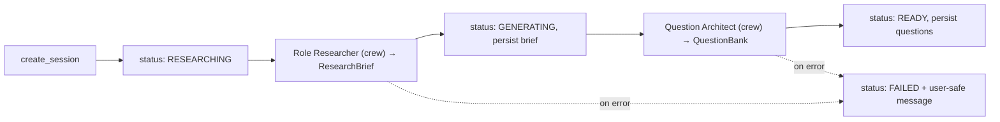
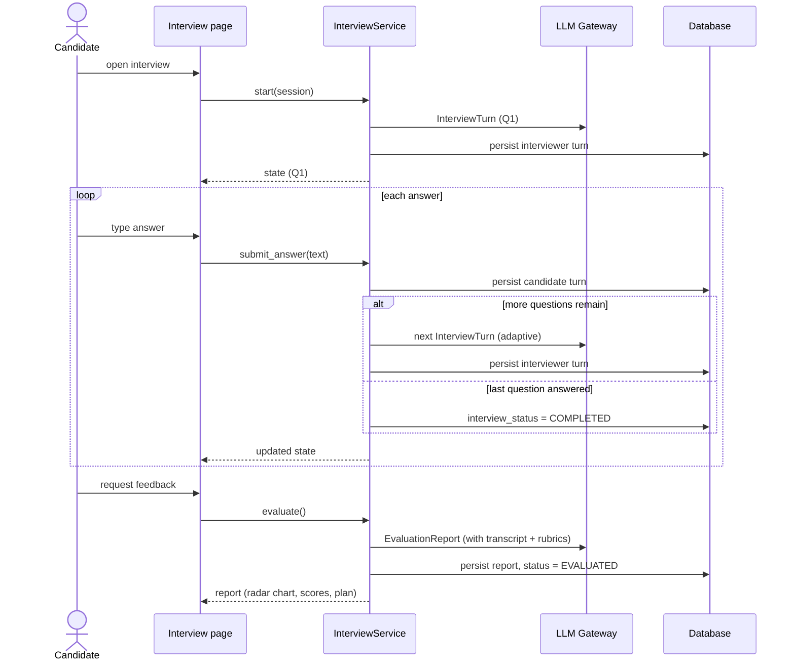

# Architecture

## Layering

```
app/config.py        configuration (pydantic-settings)
app/main.py          NiceGUI entrypoint + /healthz
app/domain/          pure enums — no IO
app/db/              SQLAlchemy models, repositories, session, Alembic, bootstrap
app/services/        business logic (auth, sessions, interview, usage, security)
app/agents/          gateway, crew_llm, crews, prompts, schemas, pricing
app/ui/              NiceGUI pages + components — presentation only
app/middleware/      auth gate
```

**Dependency rule:** `ui → services → (db repositories | agents)`. The UI never
imports the DB or CrewAI; services never build SQL inline (only repositories do);
the agents layer never touches the DB (the service layer bridges them).

## The LLM gateway (single chokepoint)

`openai` is imported in exactly one module: `app/agents/gateway.py`. The gateway
owns the OpenAI sync + async clients and provides text/structured completion
methods that:

- retry transient errors (`RateLimitError`, timeouts, connection, 5xx) with
  exponential backoff + jitter (tenacity), with our own attempt budget;
- map provider errors to typed, **user-safe** exceptions (`RateLimited`,
  `LLMTimeout`, `ContextOverflow`, `CostLimitExceeded`, …);
- extract token usage and compute USD cost (`pricing.py`);
- enforce hard cost caps **before** each call;
- log every call (model, latency, tokens, cost, ids) — never prompt text at INFO.

### Why a custom CrewAI `BaseLLM`

CrewAI 1.x lets an agent use a custom `BaseLLM`. `app/agents/crew_llm.py`
implements `GatewayLLM(BaseLLM)` whose `call()` delegates to the gateway, so the
research→questions crew's traffic flows through the same retries/caps/accounting
as everything else — instead of CrewAI's own OpenAI client.

### Accounting & caps (gateway stays DB-free)

The gateway never touches the database. It enforces caps against a `UsageLedger`
that the **service layer** seeds with already-persisted spend (`UsageService`),
then persists the ledger's entries afterward. This keeps the gateway pure and
trivially fakeable in tests, while caps still hold across process restarts
(seed = real running total from `usage_records`).

## Session-creation pipeline (CrewAI)

Two sequential single-agent crews with an explicit brief handoff, run off the
event loop via `asyncio.to_thread`:



Outputs are validated Pydantic models (`ResearchBrief`, `QuestionBank`) via
`output_pydantic`. Splitting into two stages gives true `RESEARCHING → GENERATING
→ READY` progress and persists the brief as soon as it's ready.

## Live mock interview (stateful, NOT a crew)

The interview is a turn loop owned by `InterviewService` — **one interviewer LLM
call per turn**, with state in the database. It is deliberately *not* a single
`crew.kickoff()`.



Each turn seeds a fresh `UsageLedger` from persisted spend, makes one structured
call, and persists the entry — so cost caps hold across the multi-request
interview.

## Persistence

- Async SQLAlchemy 2.x; SQLite by default, Postgres by changing `APP_DATABASE_URL`.
- Portable types only; enums stored as non-native `VARCHAR + CHECK`
  (`native_enum=False`) so the schema is identical across engines.
- A constraint **naming convention** on the metadata makes Alembic autogenerate
  deterministic. The baseline migration is committed; `app.main` runs
  `alembic upgrade head` on startup.

## Decisions (resolved ambiguities → stricter/cleaner option)

- **Project location.** Built in `ai-interview-prep/` (a dedicated git repo), not
  scattered into `$HOME`, which contains unrelated projects.
- **All LLM traffic through the gateway.** Even CrewAI's crew calls route through
  `GatewayLLM → LLMGateway`, rather than letting CrewAI use its own client. This
  is what makes "never import openai outside the gateway" literally true.
- **Evaluator via the gateway, not a crew.** The Evaluator persona runs as a
  single structured gateway call (like the interviewer) rather than a
  `crew.kickoff()`. Rationale: the turn loop already lives outside crews, this
  keeps cost-capping and deterministic testing uniform, and it still honors
  "evaluation runs as a final task on demand." The research→questions pipeline
  *does* use real CrewAI crews.
- **Naive UTC everywhere.** All timestamps are stored and compared as naive UTC
  (`utcnow()`), because SQLite drops tzinfo on read; mixing aware/naive otherwise
  corrupts datetime math and `created_at >= since` filters. Consistent and
  portable to Postgres.
- **Cost caps enforced against a seeded ledger.** The gateway is DB-free; the
  service seeds caps from persisted spend and persists afterward (see above).
- **Question-bank counts are guided, not schema-enforced.** Prompts request
  ~10/8/5 questions; the schema requires non-empty lists rather than exact counts,
  so a slightly-off model response degrades gracefully instead of hard-failing.
- **Background pipeline via `asyncio.to_thread`.** Keeps services framework-
  agnostic (no NiceGUI import in services) while never blocking the event loop;
  the UI backgrounds the coroutine and polls `status`.
- **Registration reveals email-taken.** A deliberate UX trade-off (no email
  verification in v1); login remains fully non-enumerable.
