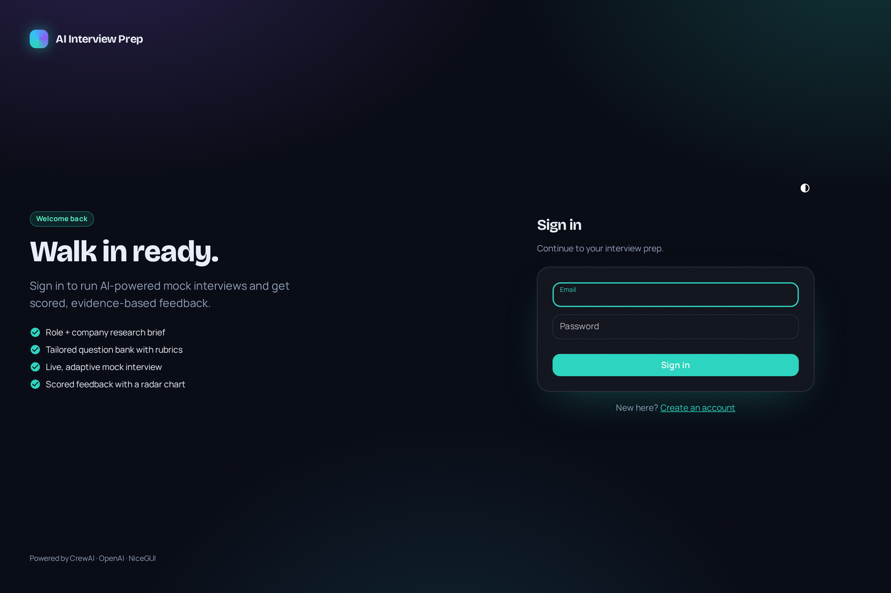
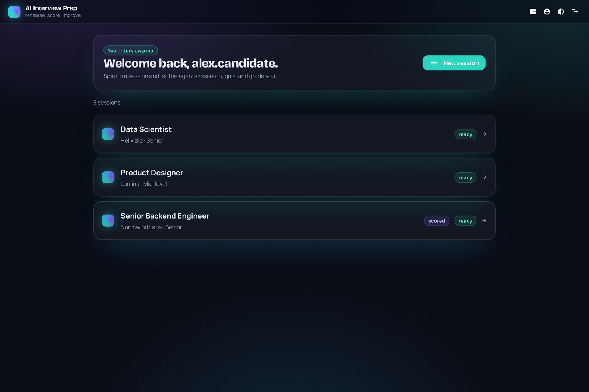
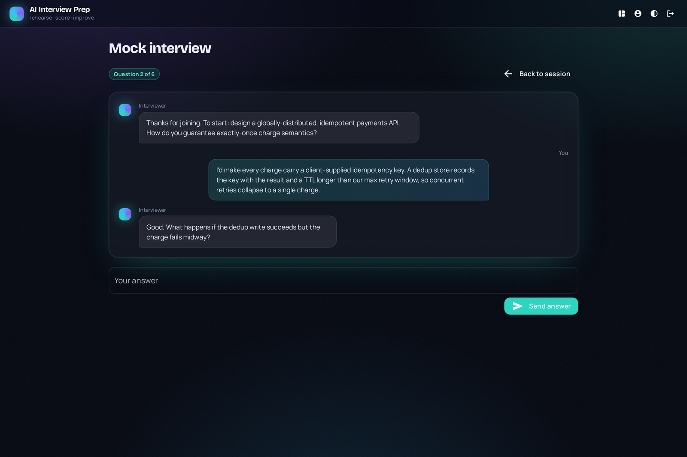
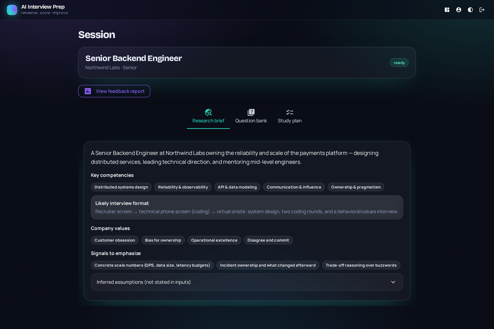
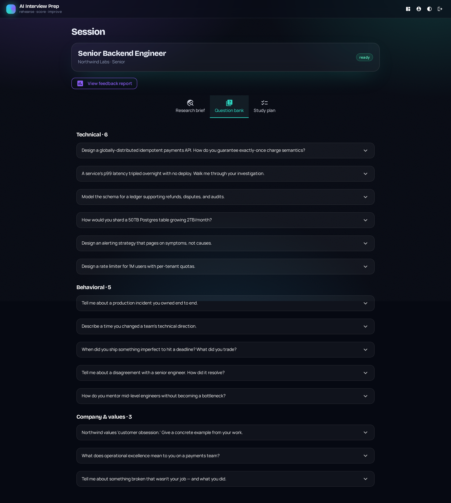
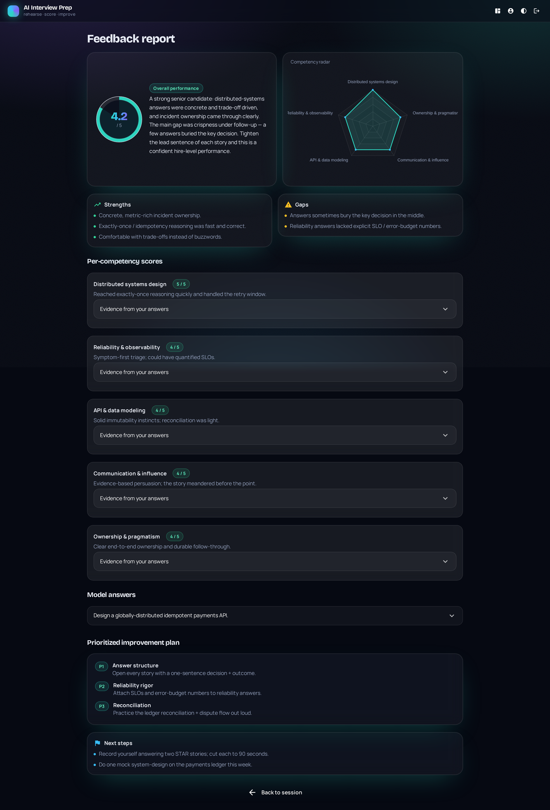
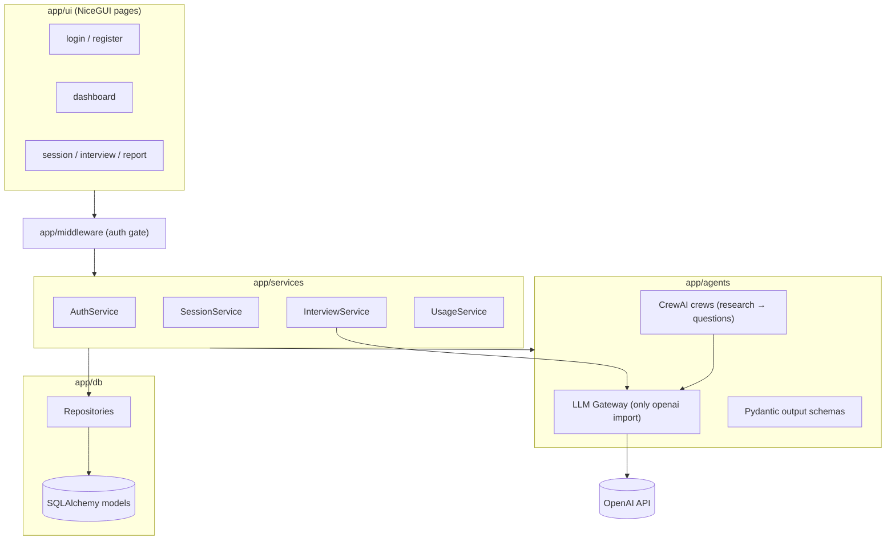

<h1 align="center">AI Interview Prep</h1>

<p align="center">
  <em>Rehearse the interview before the interview.</em><br>
  A production-grade web app that prepares candidates with a <b>CrewAI multi-agent pipeline</b>,
  the <b>OpenAI API</b>, and a <b>NiceGUI</b> frontend.
</p>

<p align="center">
  
  
  
  
  
  
  
  
  <a href="https://github.com/tonyc973/ai-interview-prep/actions/workflows/ci.yml">
    </a>
</p>

<p align="center">
  
</p>

A candidate registers, creates a prep session (target role, company, seniority,
job description, optional CV), and the system:

1. **Researches** the role/company into a structured brief.
2. **Designs** a tailored question bank (technical, behavioral, company/values) with rubrics and a study plan.
3. Runs a **live, turn-by-turn mock interview** with an adaptive interviewer agent.
4. Produces a **structured evaluation report** — per-competency scores (1–5) with transcript evidence, strengths, gaps, model answers, and a prioritized improvement plan (with a radar chart).

All sessions, transcripts, and reports are persisted and browsable.

## Screenshots

|  |  |
| :---: | :---: |
| **Dashboard** | **Live mock interview** |
|  |  |
| **Research brief** | **Tailored question bank** |
|  |  |

<p align="center"><b>Scored feedback report — per-competency radar, evidence, and a prioritized plan</b></p>
<p align="center"></p>

## Stack

| Concern | Choice |
| --- | --- |
| Language / tooling | Python 3.12, [uv](https://docs.astral.sh/uv/) (locked deps) |
| Agents | CrewAI 1.x (custom `BaseLLM` → our gateway) |
| LLM provider | OpenAI SDK (the only place `openai` is imported) |
| Frontend | NiceGUI 3.x (incl. auth) |
| Persistence | SQLAlchemy 2 (async) + SQLite, Postgres-swappable; Alembic |
| Config / validation | Pydantic v2 + pydantic-settings |
| Logging | structlog (JSON) |
| Tests / quality | pytest, ruff, mypy --strict |

## Quickstart (local)

```bash
make install                 # uv sync (locked)
cp .env.example .env         # then set APP_OPENAI_API_KEY and APP_STORAGE_SECRET
python -c "import secrets; print(secrets.token_urlsafe(48))"   # generate a storage secret
make upgrade                 # apply DB migrations
make dev                     # http://localhost:8080  (also runs migrations on startup)
```

The app **fails fast** at startup if required configuration is missing, printing
exactly which variables to fix.

### Docker

```bash
cp .env.example .env         # set the two required secrets
docker compose up --build    # http://localhost:8080
```

## Configuration

All config comes from the environment, prefixed `APP_` (see `.env.example`).
`.env` is gitignored; update `.env.example` whenever you add a variable.

| Variable | Required | Default | Purpose |
| --- | --- | --- | --- |
| `APP_OPENAI_API_KEY` | ✅ | — | OpenAI key used by the gateway |
| `APP_STORAGE_SECRET` | ✅ | — | Signs NiceGUI server-side user storage (≥32 chars) |
| `APP_DATABASE_URL` | | `sqlite+aiosqlite:///./data/app.db` | Async SQLAlchemy URL (Postgres: `postgresql+asyncpg://…`) |
| `APP_OPENAI_DEFAULT_MODEL` | | `gpt-4o-mini` | Default model for all agents |
| `APP_MODEL_ROLE_RESEARCHER` … `_EVALUATOR` | | (default) | Per-agent model overrides |
| `APP_OPENAI_REQUEST_TIMEOUT_S` | | `60` | Per-request timeout |
| `APP_OPENAI_MAX_RETRIES` | | `4` | Gateway retry attempts (exp. backoff + jitter) |
| `APP_MAX_COST_PER_SESSION_USD` | | `0.50` | Hard cap on LLM spend per session |
| `APP_MAX_COST_PER_USER_PER_DAY_USD` | | `5.00` | Hard cap on LLM spend per user/day |
| `APP_MAX_JD_CHARS` / `APP_MAX_CV_CHARS` | | `20000` | Input length limits |
| `APP_INTERVIEW_DEFAULT_QUESTIONS` | | `8` | Mock-interview length |
| `APP_PASSWORD_MIN_LENGTH` | | `12` | Minimum password length |
| `APP_PASSWORD_MIN_ZXCVBN_SCORE` | | `3` | Minimum zxcvbn strength (0–4) |
| `APP_LOGIN_MAX_FAILURES` | | `5` | Failures before lockout |
| `APP_LOGIN_LOCKOUT_BASE_SECONDS` / `_MAX_SECONDS` | | `2` / `900` | Exponential lockout bounds |
| `APP_ENV` | | `development` | `development` \| `production` \| `test` |
| `APP_LOG_LEVEL` | | `INFO` | Log level |
| `APP_HOST` / `APP_PORT` | | `0.0.0.0` / `8080` | Bind address |

## Commands

```
make install     Install locked dependencies (uv sync)
make dev         Run the app locally (loads .env)
make lint        ruff check + ruff format --check
make format      Auto-fix lint + format
make typecheck   mypy --strict
make test        Run all tests (LLM gateway always mocked)
make coverage    Tests + coverage; fail under 85% on services/agents/db
make migrate m=… Autogenerate a migration
make upgrade     Apply migrations to head
make smoke       ONE real OpenAI smoke run (opt-in; never in CI)
make docker      Build the production image
make check       lint + typecheck + test
```

## Architecture

Strictly layered — `ui → services → (db repositories | agents)`. The UI never
touches the DB or CrewAI directly, and **all** LLM traffic flows through a single
gateway. Full details in [ARCHITECTURE.md](ARCHITECTURE.md); security model in
[SECURITY.md](SECURITY.md).



## Project layout

```
app/
  config.py        pydantic-settings; fail-fast config
  main.py          NiceGUI entrypoint + /healthz
  domain/          pure enums (no IO)
  db/              models, repositories, session, Alembic migrations, bootstrap
  services/        auth, sessions, interview, usage, security  (business logic)
  agents/          gateway, crew_llm, crews, prompts, schemas, pricing
  ui/              NiceGUI pages + components (presentation only)
  middleware/      auth gate
tests/             unit/ + integration/  (gateway always mocked)
```

## Testing

```bash
make coverage    # gates services/, agents/, db/ at ≥85%
```

Tests **never** hit OpenAI: a `FakeGateway` returns deterministic, schema-valid
objects, so the full lifecycle — including the real CrewAI crew — runs offline.
The only network path is the opt-in `make smoke`.
