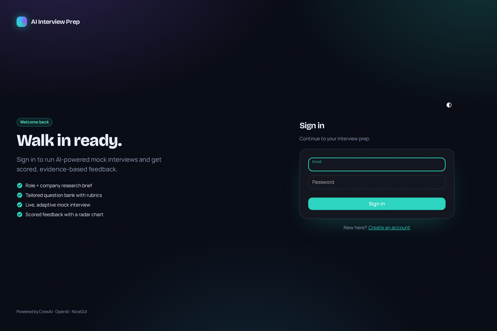
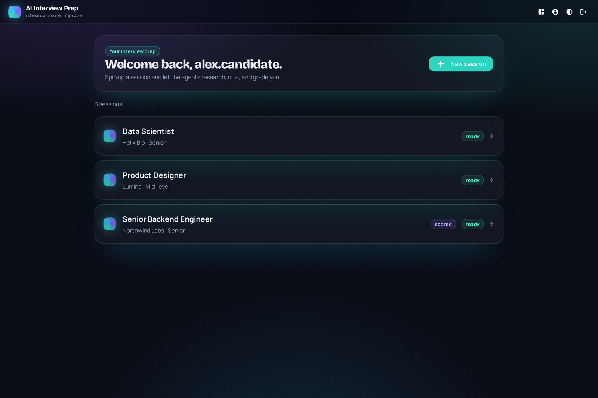
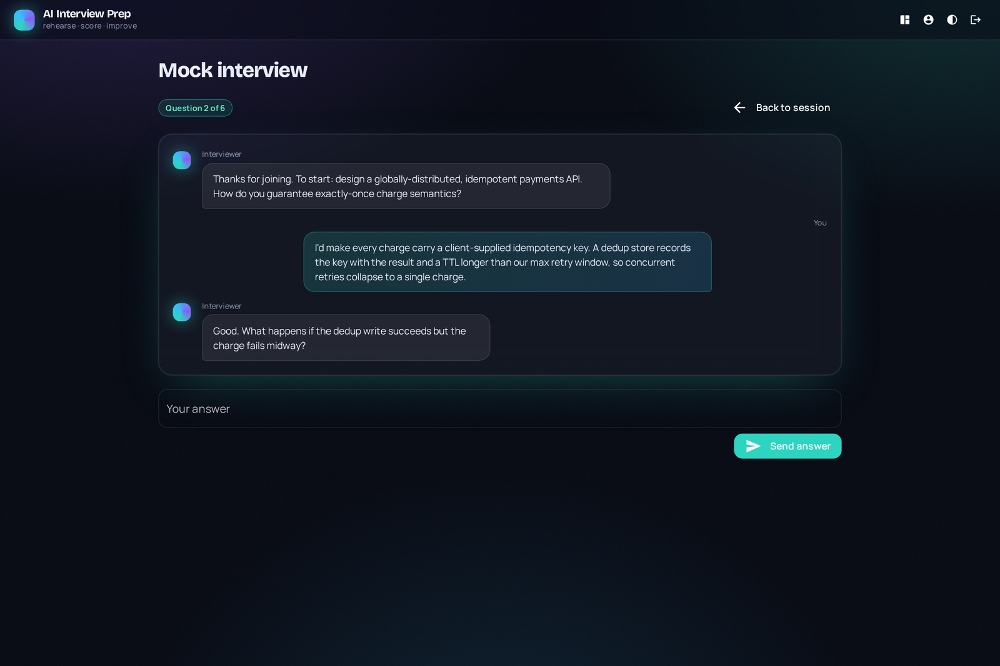
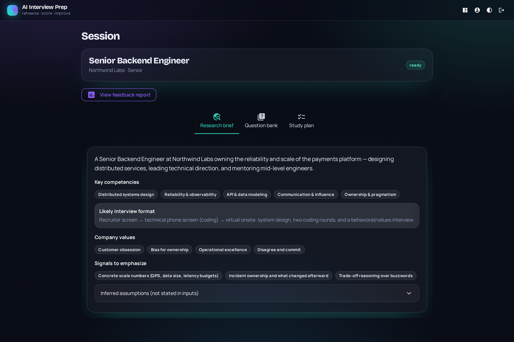
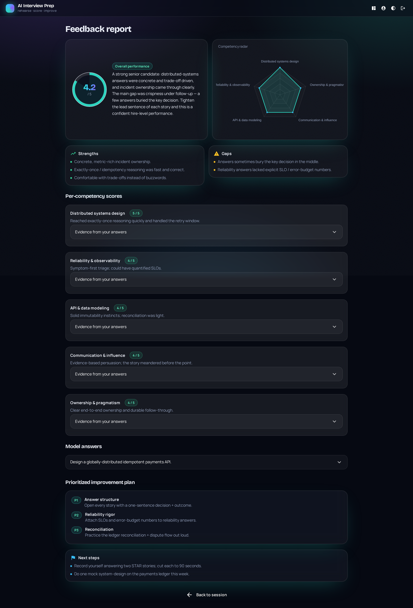

# 🚀 I built an AI interview coach that actually interviews you

**AI Interview Prep** is a production-grade web app that turns a job posting into a
full prep program — and then runs a realistic, adaptive mock interview that scores
you on evidence, not vibes.

<p align="center">
  
</p>

## The idea

Most interview prep is generic. This builds a program around *your* target role and
company. Paste a job description (and optionally your CV), and a **CrewAI multi-agent
pipeline** goes to work:

1. 🔎 **Role Researcher** turns the posting into a structured brief — key competencies,
   likely interview format, company values — and explicitly flags every inference as an
   assumption (no made-up "facts").
2. 🧩 **Question Architect** designs a tailored bank: technical, behavioral (STAR), and
   company/values questions, each with a difficulty, a target competency, and a grading
   rubric — plus a study plan.
3. 🎙️ **Mock Interviewer** runs a live, turn-by-turn chat. It asks one question at a time
   and adapts follow-ups to your answers.
4. 📊 **Evaluator** scores every competency 1–5 with **direct quotes from your answers**
   as evidence, then hands you strengths, gaps, model answers, and a prioritized plan —
   visualized on a radar chart.

<table>
  <tr>
    <td width="50%"></td>
    <td width="50%"></td>
  </tr>
  <tr>
    <td align="center"><em>Your sessions</em></td>
    <td align="center"><em>Live, adaptive interview</em></td>
  </tr>
  <tr>
    <td width="50%"></td>
    <td width="50%"></td>
  </tr>
  <tr>
    <td align="center"><em>Role + company research brief</em></td>
    <td align="center"><em>Scored feedback with a competency radar</em></td>
  </tr>
</table>

## What I'm proud of (the engineering)

This isn't a demo — it's built like something you'd actually deploy:

- 🧠 **One LLM gateway.** `openai` is imported in exactly *one* module. Every call —
  even CrewAI's — flows through it for retries (exponential backoff + jitter), timeouts,
  per-call cost accounting, and **hard cost caps** per session and per user/day.
- 🔒 **Real auth.** argon2id hashing, generic login errors (no user enumeration),
  constant-time failure paths, and **persisted, exponential login lockout** per account
  and per IP.
- 🧱 **Strict layering.** `ui → services → (db | agents)`. The UI is presentation only.
- ✅ **Validated everywhere.** Agents return Pydantic models via OpenAI structured
  outputs — never regex over free text.
- 🧪 **Quality gates that pass.** `ruff`, `mypy --strict`, 50 tests at **~89% coverage**,
  Alembic migrations, multi-stage Docker (non-root), and GitHub Actions CI.
- 🧪 **Tests never hit OpenAI.** A fake gateway drives the *real* CrewAI pipeline offline.

## Stack

Python 3.12 · CrewAI 1.x · OpenAI · NiceGUI 3.x · SQLAlchemy 2 (async) + SQLite
(Postgres-swappable) · Alembic · Pydantic v2 · structlog · pytest · ruff · mypy · Docker

## Try it

```bash
git clone https://github.com/tonyc973/ai-interview-prep
cd ai-interview-prep && make install
cp .env.example .env   # set APP_OPENAI_API_KEY + APP_STORAGE_SECRET
make dev               # → http://localhost:8080
```

⭐ Star the repo if you'd use this before your next interview.
